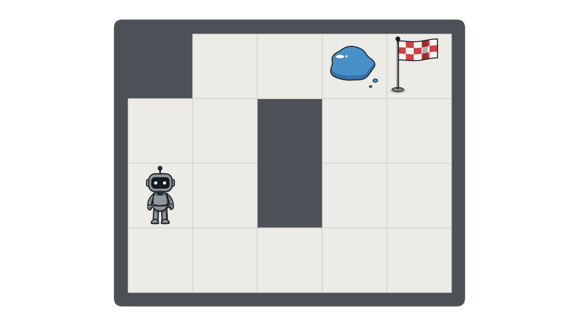
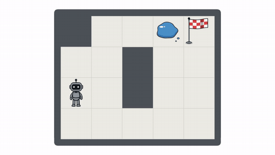
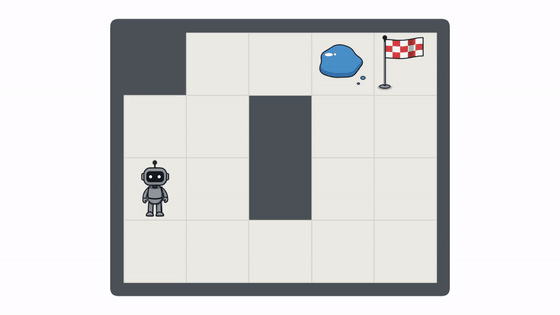
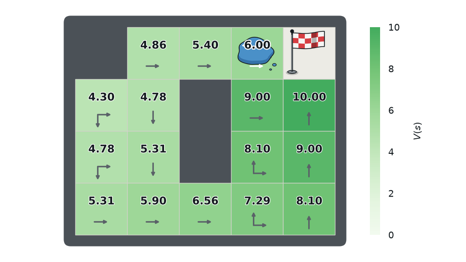
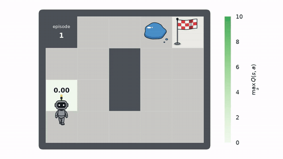
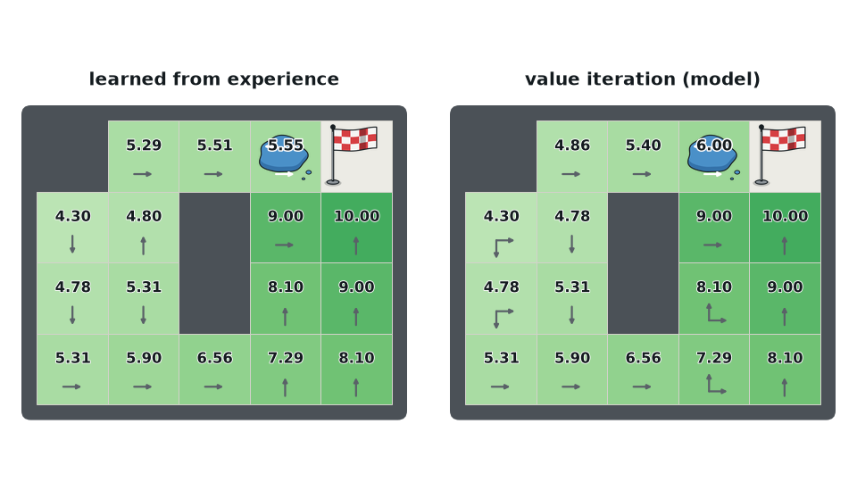
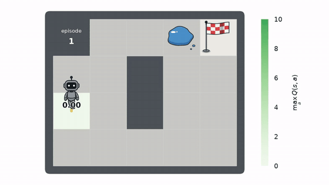
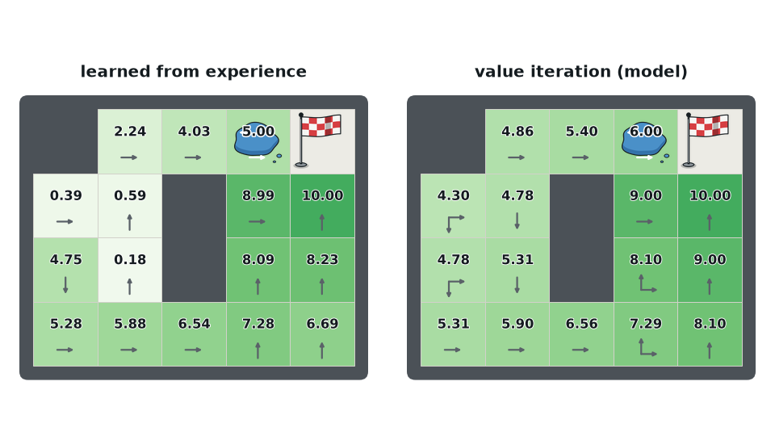

# RL Demo

Small, readable tabular reinforcement learning on a grid world, with animations.

A robot starts at **S** and wants to reach the flag (**+10**). The direct route crosses a
puddle: any step taken from the puddle slips with probability 0.2 (**−10**, episode over).
Discount γ = 0.9. The safe detour around the bottom is optimal.

<p align="center"></p>

| Optimal policy | Slipping on the puddle |
|:---:|:---:|
|  |  |

## Setup
```bash
python3 -m venv .venv && .venv/bin/pip install -r requirements.txt
.venv/bin/pytest -q
```
Animations need `ffmpeg` (with libx264) on the `PATH`. All outputs go to `out/`.

## Code
| File | Contents |
|---|---|
| `gridworld.py` | layout, dynamics, rewards |
| `algorithms.py` | value iteration, policy evaluation, rollouts, Q-learning, Monte Carlo control |
| `render.py` | drawing and video export |
| `demos/` | one script per figure or animation |

## Demos

### Value iteration
```bash
python -m demos.value_iteration
```
<p align="center"></p>

### Random behaviour
50 random-policy episodes, each step coloured by the return from there on.
```bash
python -m demos.random_rollouts
```
<p align="center"></p>

### Q-learning
ε-greedy Q-learning; the heatmap shows max<sub>a</sub> Q(s, a) as it is learned.
```bash
python -m demos.q_learning
```
<p align="center"></p>
<p align="center"></p>

### Monte Carlo control
Every-visit Monte Carlo control with ε = 1/k. Q is only updated at the end of each episode.
```bash
python -m demos.mc_control
```
<p align="center"></p>
<p align="center"></p>

### More
```bash
python -m demos.world                                   # static picture of the world
python -m demos.episode --policy random --seed 3        # one episode of any policy
python -m demos.episode --actions "up right up right right right" --slip
python -m demos.q_learning --episodes 500 --eps-min 0.1 # try other settings
python -m demos.mc_control --epsilon 1/sqrt --seed 1
```
Every demo accepts `--layout small|large`, `--width`, `--height` and `--out`; run with `-h` for all options.
